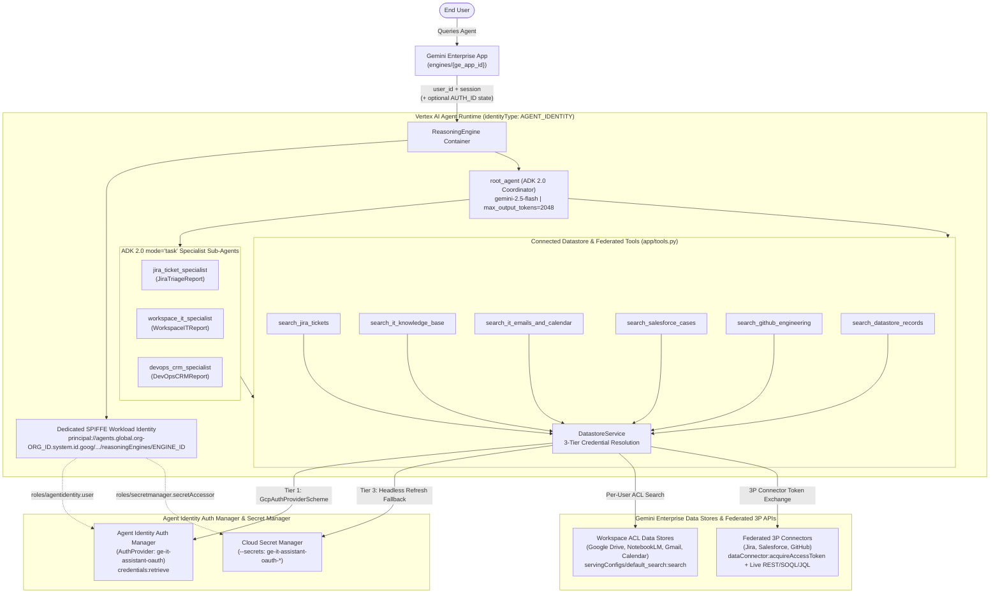

# Production-Grade ADK 2.0 Agents for Gemini Enterprise (`ge-production-adk-agent`)

Use this skill whenever asked to design, scaffold, implement, debug, evaluate, harden, or deploy a custom **ADK 2.0 (`google-adk >= 2.0.0`)** agent that integrates with **Gemini Enterprise** data stores and Out-of-the-Box (OOTB) connectors on **Vertex AI Agent Engine (`ReasoningEngine`)** using **Agent Identity** and **Agent Identity Auth Manager**.

---

## 1. Architectural Foundation (5-Layer Stack + Agent Identity)



Every production Gemini Enterprise ADK agent should follow this 5-layer architecture:

1. **Layer 1 — Single-Project Topology & Dedicated Agent Identity (`AGENT_IDENTITY`)**:
   - Co-locate the Gemini Enterprise App (`engines/{ge_app_id}`), Discovery Engine Data Stores/Connectors, Agent Identity Auth Manager (`AuthProvider`), and Vertex AI Reasoning Engine in a **single Google Cloud project**.
   - Deploy the Reasoning Engine with `--agent-identity` (`identityType: AGENT_IDENTITY`) so it receives a dedicated cryptographic SPIFFE principal (`principal://agents.global.org-${ORG_ID}.system.id.goog/resources/aiplatform/projects/${PROJECT_NUMBER}/locations/${REGION}/reasoningEngines/${ENGINE_ID}`) instead of sharing the project-wide Reasoning Engine service account.
   - Bind least-privilege IAM roles (`roles/agentidentity.user`, `roles/secretmanager.secretAccessor`, `roles/aiplatform.user`, `roles/discoveryengine.viewer`) directly to the agent's SPIFFE principal.
2. **Layer 2 — Identity, Auth Manager & ACL Alignment**:
   - **Agent Identity Auth Manager (`AuthProvider` + `GcpAuthProviderScheme`)**: Register a 3LO `AuthProvider` (`agentidentity.googleapis.com`) and call `POST https://agentidentitycredentials.googleapis.com/v1/{auth_provider}/credentials:retrieve` at tool execution time so user OAuth tokens are brokered out-of-band rather than stored in session state.
   - **Google Workspace Connectors (Drive, Gmail, Calendar)**: Authenticate using Google Cloud Identity matching the Workspace domain.
   - **3P Workforce Identity Federation (Entra ID / Okta for SharePoint / Confluence)**: Standard Google OAuth tokens do not match Workforce Identity Federation (WIF) ACLs; exchange the user's 3P OIDC token via the Google Cloud Security Token Service (`https://sts.googleapis.com/v1/token`) before calling Discovery Engine `:search`.
3. **Layer 3 — Hybrid Retrieval (Balancing Search Index Latency vs. Live Transactional State)**:
   - Do not rely solely on asynchronous Discovery Engine search ingestion for live transactional tickets or cases (Jira, Salesforce, ServiceNow, GitHub), especially when third-party connectors have scheduled sync intervals or `autoRunDisabled: true` on search ingestion.
   - Combine **Discovery Engine `:search`** (for unstructured documents and runbooks with `pageSize=10–12`) with **live federated REST API queries** authenticated via `dataConnector:acquireAccessToken`.
   - Enforce a **Read-Only Default**: Expose only read/search actions by default, and gate any mutating connector operations behind `FunctionTool(..., require_confirmation=True)`.
4. **Layer 4 — UI Card & Branding Truncation Specifications**:
   - **Avatar**: `1:1` square SVG or PNG (`< 1 MB`, minimum `256x256px`).
   - **Display Name**: `25–35 characters` (e.g., `"Enterprise IT Assistant"`, 23 chars).
   - **Card Description**: `80–150 characters` (**hard ceiling `< 180 chars`** so it never truncates with `...` in the Gemini Enterprise Agent Gallery).
5. **Layer 5 — ADK 2.0 Coordinator + `mode="task"` Sub-Agents + Execution Budgets**:
   - Keep `app = App(root_agent=root_agent, name="app")` at module level in `app/agent.py`.
   - Pin explicit model versions (e.g., `gemini-2.5-flash` or `gemini-2.5-pro`); **never** use floating aliases (`gemini-flash-latest`) in production.
   - Enforce explicit per-turn token and retry budgets on `root_agent` and all `mode="task"` specialist sub-agents:
     ```python
     import os
     from google.adk.agents import Agent
     from google.adk.apps import App
     from google.genai import types

     PINNED_MODEL = os.environ.get("AGENT_MODEL", "gemini-2.5-flash")

     RETRY_OPTIONS = types.HttpRetryOptions(
         attempts=3,
         initial_delay=1.0,
         backoff_factor=2.0,
     )

     EXECUTION_BUDGET_CONFIG = types.GenerateContentConfig(
         max_output_tokens=2048,
         temperature=0.1,
     )
     ```

---

## 2. Accessing ACL-Protected Datastores & Federated 3P Connectors (`DatastoreService`)

### Why Built-In `VertexAiSearchTool` Fails on ACL-Protected Connectors
When an ADK agent runs on Vertex AI Agent Engine, ADK's built-in `VertexAiSearchTool` authenticates using the workload identity or default service account (`service-<PROJECT_NUMBER>@gcp-sa-aiplatform-re.iam.gserviceaccount.com`). Because that identity is not a licensed end-user in the identity provider:
- Discovery Engine's Stage 2 ACL Security Filter rejects Google Drive / Gmail / Calendar queries with **`403 Forbidden`** or returns **`0` documents**.
- Discovery Engine rejects 3LO `dataConnector:acquireAccessToken` calls (Jira, Salesforce, GitHub) with **`401 Unauthorized`**.

### The 3-Tier Token Resolution & Hybrid Connector Pattern (`app/tools.py`)
Implement a custom `DatastoreService` that resolves end-user OAuth tokens across three tiers (Agent Identity Auth Manager $\to$ Gemini Enterprise `tool_context.state` $\to$ Secret Manager / ADC fallback) and supports both ingested search and live federated connector token exchange:

```python
from google.adk.auth.auth_schemes import CustomAuthScheme
from pydantic import Field

AUTH_NAME = os.environ.get("AUTH_NAME", "it_assistant_oauth_token")


class GcpAuthProviderScheme(CustomAuthScheme):
    """ADK 2.0 Agent Identity Auth Manager authentication scheme (`gcpAuthProviderScheme`)."""

    type_: str = Field(default="gcpAuthProviderScheme", alias="type")
    name: str
    scopes: list[str] | None = None
    continue_uri: str | None = None


def _retrieve_token_from_auth_manager(
    tool_context: ToolContext | None = None,
) -> str | None:
    """Tier 1: Retrieve ephemeral end-user OAuth token via Agent Identity Auth Manager."""
    auth_provider = os.environ.get("GCP_AUTH_PROVIDER_NAME")
    if not auth_provider:
        return None
    user_id = (
        getattr(tool_context, "user_id", None)
        or os.environ.get("DEFAULT_AUTH_USER_ID")
        or "admin@acme-co.example.com"
    )
    creds, _ = google.auth.default()
    creds.refresh(google.auth.transport.requests.Request())
    resp = requests.post(
        f"https://agentidentitycredentials.googleapis.com/v1/{auth_provider}/credentials:retrieve",
        headers={
            "Authorization": f"Bearer {creds.token}",
            "Content-Type": "application/json",
        },
        json={
            "userId": user_id,
            "scopes": ["https://www.googleapis.com/auth/cloud-platform"],
            "continueUri": os.environ.get(
                "GCP_AUTH_CONTINUE_URI", "https://vertexaisearch.cloud.google.com"
            ),
        },
        timeout=10,
    )
    if resp.status_code == 200:
        token = (resp.json().get("success") or {}).get("token")
        if isinstance(token, str) and token.strip():
            return token.strip()
    return None


def _extract_access_token(tool_context: ToolContext | None) -> str | None:
    """Resolves token via Tier 1 (Auth Manager) or Tier 2 (Gemini Enterprise tool_context.state)."""
    broker_token = _retrieve_token_from_auth_manager(tool_context)
    if broker_token:
        return broker_token
    if (
        tool_context is None
        or not hasattr(tool_context, "state")
        or tool_context.state is None
    ):
        return None
    state = tool_context.state
    candidate_keys = [
        AUTH_NAME,
        f"temp:{AUTH_NAME}",
        "access_token",
        "temp:access_token",
        "oauth_token",
        "temp:oauth_token",
    ]
    if hasattr(state, "to_dict"):
        state_dict = state.to_dict()
        for k in candidate_keys:
            if state_dict.get(k):
                return str(state_dict[k])
        for k, v in state_dict.items():
            if AUTH_NAME in k and v and isinstance(v, str):
                return v
    return None
```

#### Tier 3: Secret Manager (`--secrets`) / Environment User OAuth Refresh Fallback
When Gemini Enterprise invokes `:streamQuery` without `state_delta` (or during local/automated `agents-cli eval` runs), mint a user OAuth token from Google Cloud Secret Manager (`ge-it-assistant-oauth-client-id`, `-secret`, `-refresh-token`) or environment variables, and automatically retry any `401/403` response:

```python
def _retry_with_user_oauth_if_unauthorized(fn, tool_context: ToolContext | None):
    """Executes fn(service); on 401/403 when state had no token, retries with refreshed User OAuth token."""
    state_token = _extract_access_token(tool_context)
    user_token = state_token or _get_user_oauth_token()
    service = DatastoreService(access_token=user_token)
    try:
        return fn(service)
    except requests.exceptions.HTTPError as exc:
        status_code = exc.response.status_code if exc.response is not None else None
        if status_code in (401, 403):
            fresh_user_token = _get_user_oauth_token()
            if fresh_user_token and fresh_user_token != user_token:
                return fn(DatastoreService(access_token=fresh_user_token))
        raise
```

#### Tier 3: Discovery Engine `:search` (`pageSize=10–12`) + `dataConnector:acquireAccessToken`
1. **Ingested Datastore Search (Drive, Gmail, Calendar, Docs)**:
   - Endpoint: `POST https://{prefix}discoveryengine.googleapis.com/v1alpha/projects/{project}/locations/{location}/collections/default_collection/dataStores/{datastore_id}/servingConfigs/default_search:search`
   - Always pass `"pageSize": 10` (or `12`) so Stage 4 (Answer Synthesis Context Window) does not drop relevant documents ranked `#6–#10`.
2. **Federated 3P Connector Token Exchange (Jira, Salesforce, GitHub)**:
   - Endpoint: `GET https://{prefix}discoveryengine.googleapis.com/v1alpha/projects/{project}/locations/{location}/collections/{connector_id}/dataConnector:acquireAccessToken`
   - Header: `Authorization: Bearer {user_oauth_token}`, `X-Goog-User-Project: {project}`
   - Returns `{"accessToken": "<3p_saas_token>", "connectorCredentials": "..."}` which your tool uses to query:
     - **Jira Cloud REST API v3**: `POST https://api.atlassian.com/ex/jira/{cloud_id}/rest/api/3/search/jql`
     - **Salesforce REST API**: `GET {instance_url}/services/data/v60.0/query?q={soql}`
     - **GitHub REST API**: `GET https://api.github.com/search/repositories` or `/search/issues`

---

## 3. Scaffolding & Hermetic Dependency Configuration (`agents-cli` + `uv`)

### Step 1: Scaffold with `agents-cli`
```bash
agents-cli scaffold create <agent-name> \
  --deployment-target agent_runtime \
  --region us-central1 \
  --include-ci
```

### Step 2: Pin Public PyPI & Compatible ADK/Vertex Versions in `pyproject.toml`
> [!IMPORTANT]
> Custom workstation package index configurations or unpinned major versions can cause:
> 1. **Cloud Build failures** during `agents-cli deploy` if `uv.lock` references private/unreachable package mirrors.
> 2. **`agents-cli eval generate` errors** (`TypeError: Unsupported dataset type` on `EvaluationDataset`) if an incompatible major version of `google-cloud-aiplatform` (`>=2.0.0`) is resolved.

Always configure `pyproject.toml` with explicit upper bounds and public PyPI:
```toml
dependencies = [
    "google-adk[gcp]>=2.0.0,<2.4.0",
    "google-cloud-aiplatform[evaluation,agent-engines]>=1.156.0,<2.0.0",
    "google-cloud-secret-manager>=2.20.0",
    "google-auth>=2.35.0",
    "requests>=2.32.0",
    "fastapi>=0.115.0",
    "uvicorn>=0.34.0",
    "pydantic>=2.11.0",
    "python-dotenv>=1.0.1",
]

[[tool.uv.index]]
name = "pypi"
url = "https://pypi.org/simple"
default = true
```

And always run `uv` / `agents-cli` commands with `UV_NO_CONFIG=1`:
```bash
UV_NO_CONFIG=1 uv lock --upgrade
UV_NO_CONFIG=1 uv sync
```

---

## 4. Lint, Test & Dual-Axis Golden Dataset Evaluation (Phase 4 Gate)

Before deploying to Vertex AI Agent Runtime, run all three local verification gates:

```bash
# 1. Static Analysis & Type Checking (ruff check, ruff format, codespell, ty check)
UV_NO_CONFIG=1 agents-cli lint

# 2. Unit & E2E Server Integration Tests
UV_NO_CONFIG=1 uv run pytest tests/unit tests/integration -v

# 3. Golden Dataset Trajectory & LLM-as-a-Judge Evaluation
UV_NO_CONFIG=1 agents-cli eval generate
UV_NO_CONFIG=1 agents-cli eval grade
```

- **Exit Criteria**:
  - **S1 Gate (Zero Tolerance)**: `100%` pass rate (`0` ACL leaks, `0` `401/403` errors, `1.00` `tool_invocation_check`).
  - **S2 Gate (Quality)**: $\ge 90\%$ pass rate with mean LLM-as-a-Judge score $\ge 4.0 / 5.0$ (`custom_response_quality`).

---

## 5. Secret Manager, Observability, Deployment & GE Registration

### Step 1: Store Runtime OAuth Credentials in Secret Manager & Grant IAM
```bash
printf "%s" "$USER_OAUTH_CLIENT_ID" | gcloud secrets create ge-it-assistant-oauth-client-id --data-file=- --project="$PROJECT_ID"
printf "%s" "$USER_OAUTH_CLIENT_SECRET" | gcloud secrets create ge-it-assistant-oauth-client-secret --data-file=- --project="$PROJECT_ID"
printf "%s" "$USER_OAUTH_REFRESH_TOKEN" | gcloud secrets create ge-it-assistant-oauth-refresh-token --data-file=- --project="$PROJECT_ID"

# Grant Secret Accessor to Reasoning Engine & Discovery Engine Service Agents
for SA in \
  "service-${PROJECT_NUMBER}@gcp-sa-aiplatform-re.iam.gserviceaccount.com" \
  "service-${PROJECT_NUMBER}@gcp-sa-discoveryengine.iam.gserviceaccount.com"; do
  for SEC in ge-it-assistant-oauth-client-id ge-it-assistant-oauth-client-secret ge-it-assistant-oauth-refresh-token; do
    gcloud secrets add-iam-policy-binding "$SEC" \
      --project="$PROJECT_ID" \
      --member="serviceAccount:${SA}" \
      --role="roles/secretmanager.secretAccessor"
  done
done
```

### Step 2: Register Discovery Engine `Authorization` Resource (`AUTH_ID`)
```bash
curl -s -X POST \
  -H "Authorization: Bearer $(gcloud auth print-access-token)" \
  -H "Content-Type: application/json" \
  -H "X-Goog-User-Project: ${PROJECT_ID}" \
  "https://discoveryengine.googleapis.com/v1alpha/projects/${PROJECT_ID}/locations/global/authorizations?authorizationId=${AUTH_NAME}" \
  -d "{
    \"name\": \"projects/${PROJECT_ID}/locations/global/authorizations/${AUTH_NAME}\",
    \"serverSideOauth2\": {
      \"clientId\": \"${USER_OAUTH_CLIENT_ID}\",
      \"clientSecret\": \"${USER_OAUTH_CLIENT_SECRET}\",
      \"authorizationUri\": \"https://accounts.google.com/o/oauth2/v2/auth?scope=https%3A%2F%2Fwww.googleapis.com%2Fauth%2Fcloud-platform&access_type=offline&prompt=consent\",
      \"tokenUri\": \"https://oauth2.googleapis.com/token\"
    }
  }"
```

### Step 3: Enable Sensitive Observability Logging on the GE App (Dev/UAT)
Without `sensitiveLoggingEnabled: true`, Cloud Logging entries for Gemini Enterprise turns will omit query/response payloads:
```bash
curl -s -X PATCH \
  -H "Authorization: Bearer $(gcloud auth print-access-token)" \
  -H "Content-Type: application/json" \
  -H "X-Goog-User-Project: ${PROJECT_ID}" \
  "https://discoveryengine.googleapis.com/v1alpha/projects/${PROJECT_NUMBER}/locations/global/collections/default_collection/engines/${GE_APP_ID}?updateMask=observabilityConfig" \
  -d '{"observabilityConfig": {"observabilityEnabled": true, "sensitiveLoggingEnabled": true}}'
```

### Step 4: Deploy with Agent Identity (`--agent-identity`), Configure Auth Manager & Publish to Gemini Enterprise

Deploy with `--agent-identity` (`identityType: AGENT_IDENTITY`) and `--secrets` so the Reasoning Engine receives a dedicated cryptographic SPIFFE principal (`principal://agents.global.org-${ORG_ID}.system.id.goog/resources/aiplatform/projects/${PROJECT_NUMBER}/locations/us-central1/reasoningEngines/${REASONING_ENGINE_ID}`) instead of sharing the default project service account:

```bash
UV_NO_CONFIG=1 agents-cli deploy \
  --project "$PROJECT_ID" \
  --region us-central1 \
  --service-name "$AGENT_SERVICE_NAME" \
  --agent-identity \
  --secrets "USER_OAUTH_CLIENT_ID=ge-it-assistant-oauth-client-id:latest,USER_OAUTH_CLIENT_SECRET=ge-it-assistant-oauth-client-secret:latest,USER_OAUTH_REFRESH_TOKEN=ge-it-assistant-oauth-refresh-token:latest" \
  --no-confirm-project

# Create an AuthProvider in Agent Identity Auth Manager (agentidentity.googleapis.com)
curl -s -X POST \
  -H "Authorization: Bearer $(gcloud auth print-access-token)" \
  -H "X-Goog-User-Project: ${PROJECT_ID}" \
  -H "Content-Type: application/json" \
  "https://agentidentity.googleapis.com/v1beta/projects/${PROJECT_ID}/locations/us-central1/authProviders?authProviderId=ge-it-assistant-oauth" \
  -d "{
    \"description\": \"Enterprise IT Assistant 3LO AuthProvider\",
    \"allowedScopes\": [\"https://www.googleapis.com/auth/cloud-platform\"],
    \"authProviderTypeParams\": {
      \"threeLeggedOauth\": {
        \"clientId\": \"${USER_OAUTH_CLIENT_ID}\",
        \"clientSecret\": \"${USER_OAUTH_CLIENT_SECRET}\",
        \"authorizationUrl\": \"https://accounts.google.com/o/oauth2/v2/auth\",
        \"tokenUrl\": \"https://oauth2.googleapis.com/token\",
        \"enablePkce\": true
      }
    }
  }"

# Bind roles/agentidentity.user to the agent's SPIFFE principal on the AuthProvider
SPIFFE_PRINCIPAL="principal://agents.global.org-${ORG_ID}.system.id.goog/resources/aiplatform/projects/${PROJECT_NUMBER}/locations/us-central1/reasoningEngines/${REASONING_ENGINE_ID}"
curl -s -X POST \
  -H "Authorization: Bearer $(gcloud auth print-access-token)" \
  -H "X-Goog-User-Project: ${PROJECT_ID}" \
  -H "Content-Type: application/json" \
  "https://agentidentity.googleapis.com/v1beta/projects/${PROJECT_ID}/locations/us-central1/authProviders/ge-it-assistant-oauth:setIamPolicy" \
  -d "{
    \"policy\": {
      \"bindings\": [
        {
          \"role\": \"roles/agentidentity.user\",
          \"members\": [\"${SPIFFE_PRINCIPAL}\"]
        }
      ]
    }
  }"

UV_NO_CONFIG=1 agents-cli publish gemini-enterprise \
  --ge-app-id "$GE_APP_ID" \
  --display-name "$AGENT_DISPLAY_NAME" \
  --description "$CARD_DESCRIPTION_UNDER_180_CHARS"
```

### Step 5: Verify Live `:streamQuery` Execution Without `state_delta`
Always test the deployed Reasoning Engine via `:streamQuery` (`streaming_agent_run_with_events`) **without** passing `state_delta` in the test payload to prove the agent succeeds even when Gemini Enterprise does not inject an OAuth token in `tool_context.state`:
```bash
curl -s -X POST \
  -H "Authorization: Bearer $(gcloud auth print-access-token)" \
  -H "Content-Type: application/json" \
  "https://us-central1-aiplatform.googleapis.com/v1/projects/${PROJECT_NUMBER}/locations/us-central1/reasoningEngines/${REASONING_ENGINE_ID}:streamQuery?alt=sse" \
  -d '{
    "class_method": "streaming_agent_run_with_events",
    "input": {
      "request": {
        "user_id": "ge_ui_verification_user",
        "message": {"role": "user", "parts": [{"text": "Run a cross-connector status check."}]}
      }
    }
  }'
```

---

## 6. Public Repository Scrubbing Checklist

Before committing or pushing a Gemini Enterprise ADK project to a public repository:
1. **Standardize on Mock Customer (`Acme Co.`)**: Replace all customer names, personal identifiers, and live project IDs across `app/`, `tests/`, `README.md`, `.env.example`, `.agents-cli-spec.md`, `deployment_metadata.json`, and `deployment/terraform/single-project/vars/env.tfvars` with `Acme Co.` (`acme-enterprise-demo`, `acme_ge_app`, `https://acme-co.atlassian.net`).
2. **Remove Local Runtime Artifacts**: Delete `.google-agents-cli/`, `app/.adk/`, `artifacts/`, `.venv/`, and `.env`, and ensure they are listed in `.gitignore`.
3. **Avoid Secret-Scanner False Positives in Unit Tests**: Do not use real OAuth or refresh token prefixes for mock tokens in `tests/unit/` (use `"mock_token_123456"` instead) so pre-commit secret scanners pass cleanly.
4. **Run Automated Regex Audit**: Scan all tracked files against customer names, personal handles, project numbers, connector IDs, and OAuth token prefixes and confirm `0` matches before committing.
