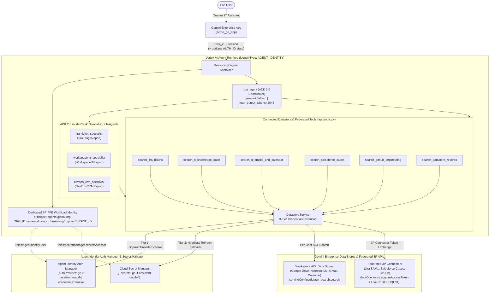

# Enterprise IT Assistant for Acme Co. (`ge-it-assistant`)

An end-to-end **ADK 2.0 (`google-adk>=2.0.0,<3.0.0`)** Enterprise IT Assistant built with `agents-cli` (`v1.1.0`) for **Gemini Enterprise** on Google Cloud.

Built on the [VeerMuchandi/Learn_ADK_Agents/ge_datastore_accessor_agent](https://github.com/VeerMuchandi/Learn_ADK_Agents/tree/main/ge_datastore_accessor_agent) blueprint, this agent connects to Discovery Engine Data Stores and Third-Party Federated Connectors configured in a Gemini Enterprise app for **Acme Co.**

---

## Architecture & Connected Data Stores



```
User / Gemini Enterprise (acme_ge_app)
       │  (Invokes ReasoningEngine with user_id + session)
       ▼
  Vertex AI Reasoning Engine (identityType: AGENT_IDENTITY)
  SPIFFE ID: principal://agents.global.org-<ORG_ID>.system.id.goog/.../reasoningEngines/<ID>
       │
       ├──► Tier 1 Auth: Agent Identity Auth Manager (GcpAuthProviderScheme)
       │      └── POST agentidentitycredentials.googleapis.com/v1/{auth_provider}/credentials:retrieve
       ├──► Tier 2 Auth: Gemini Enterprise OAuth State (tool_context.state[AUTH_NAME])
       └──► Tier 3 Auth: Cloud Secret Manager Mounts (--secrets ge-it-assistant-oauth-*) / Local ADC
       │
       ▼
  root_agent (ADK 2.0 Coordinator — gemini-2.5-flash, max_output_tokens=2048)
       ├── Fast-Path Connected Datastore Tools (app/tools.py -> DatastoreService)
       │     ├── search_datastore_records (Blueprint DataStore search)
       │     ├── search_jira_tickets (Jira Cloud SAM1 + Jira Issue DataStore)
       │     ├── search_it_knowledge_base (Google Drive + NotebookLM)
       │     ├── search_it_emails_and_calendar (Gmail + Google Calendar)
       │     ├── search_salesforce_cases (Salesforce Case DataStore + SOQL Federation)
       │     └── search_github_engineering (GitHub Repositories & Issues)
       └── ADK 2.0 mode="task" Specialist Sub-Agents (Structured Pydantic Output)
             ├── jira_ticket_specialist -> JiraTriageReport
             ├── workspace_it_specialist -> WorkspaceITReport
             └── devops_crm_specialist -> DevOpsCRMReport
```

### Connected Data Stores in Gemini Enterprise

| Connector / System | Environment Variable | Purpose |
|---|---|---|
| **Jira Cloud** | `JIRA_DATA_STORE_ID` (`SAM1`) | Sprint tasks, epics, bug tracking, and priority escalations (`SAM1-23`, `SAM1-22`, etc.) |
| **Google Drive** | `GDRIVE_DATA_STORE_ID` | IT runbooks, `GC5060` resolution plans, executive briefings, security questionnaires |
| **NotebookLM** | `GNOTEBOOK_DATA_STORE_ID` | Curated IT knowledge notebooks |
| **Gmail** | `GMAIL_DATA_STORE_ID` | Security token alerts, Connected App notices, Jira work item notifications |
| **Google Calendar** | `GCAL_DATA_STORE_ID` | IT onboarding sessions (*IT Laptop Setup*, *30-Day Check-in*, *Architecture Overview*) |
| **Salesforce** | `SF_CASE_DATA_STORE_ID` | Customer support cases and escalations (`00001002`, `00001000`, `00001001`, `00001005`) |
| **GitHub** | `GITHUB_REPO_DATA_STORE_ID` / `_ISSUE_` | Engineering repositories (`adk-salesforce-agent`, `ge-spark-gtm-demo`, `spark-demo-apps`) |

---

## Authentication, Security & Best Practices (Agent Identity + Auth Manager)

1. **Dedicated Agent Identity (`identityType: AGENT_IDENTITY`)**:
   - Deployed with `--agent-identity`, provisioning a dedicated cryptographic SPIFFE principal (`principal://agents.global.org-<ORG_ID>.system.id.goog/resources/aiplatform/projects/<PROJECT_NUMBER>/locations/us-central1/reasoningEngines/<ENGINE_ID>`) instead of sharing the default Reasoning Engine service account.
   - Least-privilege IAM roles (`roles/agentidentity.user`, `roles/secretmanager.secretAccessor`, `roles/aiplatform.user`, `roles/discoveryengine.viewer`) are bound directly to the agent's SPIFFE principal.
2. **Agent Identity Auth Manager (`AuthProvider` + `GcpAuthProviderScheme`)**:
   - Registers a 3-legged OAuth `AuthProvider` (`projects/$GCP_PROJECT/locations/us-central1/authProviders/ge-it-assistant-oauth`) in `agentidentity.googleapis.com`.
   - `DatastoreService` queries `https://agentidentitycredentials.googleapis.com/v1/{auth_provider}/credentials:retrieve` (using `GcpAuthProviderScheme`) as **Tier 1** to retrieve short-lived end-user OAuth tokens at tool execution time without persisting raw tokens in `tool_context.state`.
3. **Gemini Enterprise (`AUTH_ID` 3LO OAuth Pattern & Secret Manager Fallback)**:
   - When invoked from Gemini Enterprise before or alongside Auth Manager consent, `DatastoreService` falls back to `tool_context.state[AUTH_NAME]` (`temp:{AUTH_NAME}`) as **Tier 2** and Secret Manager OAuth refresh credentials (`USER_OAUTH_CLIENT_ID`, `USER_OAUTH_CLIENT_SECRET`, `USER_OAUTH_REFRESH_TOKEN`) mounted via `--secrets` as **Tier 3**.
4. **Local Development & Evaluation (`agents-cli run` / `agents-cli eval`)**:
   - When running locally, `DatastoreService` automatically falls back to **Application Default Credentials (ADC)**:
     ```bash
     gcloud auth application-default login
     gcloud config set project acme-enterprise-demo
     ```
   - Copy `.env.example` to `.env` and populate your project's datastore IDs (**never commit `.env`**).

---

## Quick Start & Commands

```bash
# 1. Install dependencies
agents-cli install

# 2. Run code quality & type checks
agents-cli lint

# 3. Smoke test locally
agents-cli run "What is the latest status of my Jira ticket SAM1-23?"

# 4. Run unit and integration tests
uv run pytest tests/unit tests/integration

# 5. Generate evaluation traces & grade across the 6 IT Assistant scenarios
agents-cli eval generate
agents-cli eval grade

# 6. Deploy to Vertex AI Agent Runtime (us-central1) with Agent Identity & Secret Manager bindings
agents-cli deploy \
  --project $GCP_PROJECT \
  --region us-central1 \
  --agent-identity \
  --secrets "USER_OAUTH_CLIENT_ID=ge-it-assistant-oauth-client-id:latest,USER_OAUTH_CLIENT_SECRET=ge-it-assistant-oauth-client-secret:latest,USER_OAUTH_REFRESH_TOKEN=ge-it-assistant-oauth-refresh-token:latest"

# 7. Register / Publish to Gemini Enterprise
agents-cli publish gemini-enterprise \
  --gemini-enterprise-app-id projects/$GCP_PROJECT_NUMBER/locations/global/collections/default_collection/engines/$GE_APP_ID \
  --display-name "Enterprise IT Assistant" \
  --description "End-to-end IT Assistant across Jira, Google Drive, Gmail, Google Calendar, Salesforce, and GitHub connectors." \
  --authorization-id projects/$GCP_PROJECT_NUMBER/locations/global/authorizations/it_assistant_oauth_token \
  --registration-type adk
```
